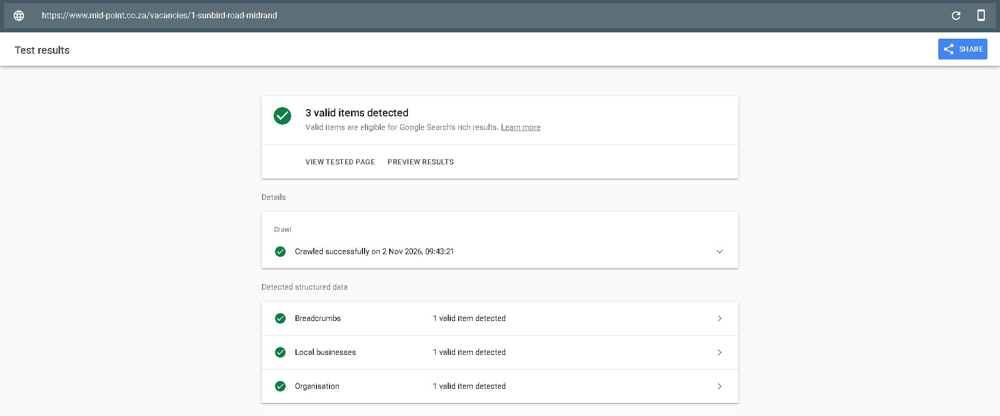
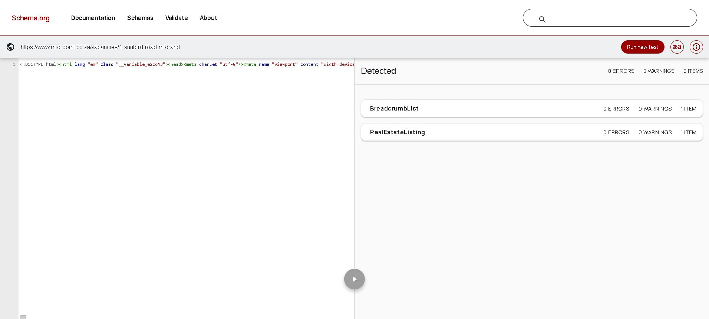

# Official vacancy structured-data validation — 2 November 2026

All **16 published vacancy URLs passed both official services**. Google Rich Results Test detected three valid items per page (Breadcrumbs, Local businesses and Organisation), with no reported issues. Schema.org Validator reported zero errors and zero warnings for every page and detected the BreadcrumbList and RealEstateListing roots. No confirmed markup issue required a code fix.

Tests used the normal Edge browser and Google Inspection Tool smartphone mode against the live URL, not pasted code. Schema.org fetched HTML containing release marker `3c2e09d55d86` in all 16 results. Production checkout/image remained at application commit `3c2e09d55d8676e13a82b6c2f7e5d9a742b9c033`; no application deployment was performed by this validation task.

The complete dated UI summaries, exact coverage and screenshot hashes are in [the JSON evidence](vacancy-official-validation-20261102.json). Google links below open the individual completed results. Schema.org hash links identify the tested input and may rerun it when opened; the saved summaries/screenshots preserve this run.

| Vacancy | Google Rich Results Test | Schema.org Validator |
|---|---|---|
| [onpoint-office-g-02-midrand](https://www.mid-point.co.za/vacancies/onpoint-office-g-02-midrand) | [3 valid items](https://search.google.com/test/rich-results/result?id=QwIQSKGZ-Cn0YC2hGF-tFw) | [0 errors, 0 warnings](https://validator.schema.org/#url=https%3A%2F%2Fwww.mid-point.co.za%2Fvacancies%2Fonpoint-office-g-02-midrand) |
| [unit-7-sunbird-road-gf-midrand](https://www.mid-point.co.za/vacancies/unit-7-sunbird-road-gf-midrand) | [3 valid items](https://search.google.com/test/rich-results/result?id=gsFLQ_rHoBIikK19usSJyw) | [0 errors, 0 warnings](https://validator.schema.org/#url=https%3A%2F%2Fwww.mid-point.co.za%2Fvacancies%2Funit-7-sunbird-road-gf-midrand) |
| [unit-1-1-weaver-avenue-midrand](https://www.mid-point.co.za/vacancies/unit-1-1-weaver-avenue-midrand) | [3 valid items](https://search.google.com/test/rich-results/result?id=j9Fqe8FeNjedMLMcsJzMQw) | [0 errors, 0 warnings](https://validator.schema.org/#url=https%3A%2F%2Fwww.mid-point.co.za%2Fvacancies%2Funit-1-1-weaver-avenue-midrand) |
| [onpoint-office-g-07-midrand](https://www.mid-point.co.za/vacancies/onpoint-office-g-07-midrand) | [3 valid items](https://search.google.com/test/rich-results/result?id=nINnH2EO1X_4c3tQgg_AiA) | [0 errors, 0 warnings](https://validator.schema.org/#url=https%3A%2F%2Fwww.mid-point.co.za%2Fvacancies%2Fonpoint-office-g-07-midrand) |
| [onpoint-office-1-02-midrand](https://www.mid-point.co.za/vacancies/onpoint-office-1-02-midrand) | [3 valid items](https://search.google.com/test/rich-results/result?id=B_EPctHwEWKldU2NNnB4vw) | [0 errors, 0 warnings](https://validator.schema.org/#url=https%3A%2F%2Fwww.mid-point.co.za%2Fvacancies%2Fonpoint-office-1-02-midrand) |
| [onpoint-office-1-04-midrand](https://www.mid-point.co.za/vacancies/onpoint-office-1-04-midrand) | [3 valid items](https://search.google.com/test/rich-results/result?id=CtBNtDdPhdxNaDNr0dF1BA) | [0 errors, 0 warnings](https://validator.schema.org/#url=https%3A%2F%2Fwww.mid-point.co.za%2Fvacancies%2Fonpoint-office-1-04-midrand) |
| [3-weaver-avenue-midrand](https://www.mid-point.co.za/vacancies/3-weaver-avenue-midrand) | [3 valid items](https://search.google.com/test/rich-results/result?id=BM3as9Wf4fS54zyb4htprw) | [0 errors, 0 warnings](https://validator.schema.org/#url=https%3A%2F%2Fwww.mid-point.co.za%2Fvacancies%2F3-weaver-avenue-midrand) |
| [unit-2-2-weaver-avenue-midrand](https://www.mid-point.co.za/vacancies/unit-2-2-weaver-avenue-midrand) | [3 valid items](https://search.google.com/test/rich-results/result?id=3RCrgT94tGu-VTqG72FLqw) | [0 errors, 0 warnings](https://validator.schema.org/#url=https%3A%2F%2Fwww.mid-point.co.za%2Fvacancies%2Funit-2-2-weaver-avenue-midrand) |
| [6-weaver-avenue-midrand](https://www.mid-point.co.za/vacancies/6-weaver-avenue-midrand) | [3 valid items](https://search.google.com/test/rich-results/result?id=6v8-3j8RJFX-oXrQAZrPrw) | [0 errors, 0 warnings](https://validator.schema.org/#url=https%3A%2F%2Fwww.mid-point.co.za%2Fvacancies%2F6-weaver-avenue-midrand) |
| [2-kingfisher-avenue-midrand](https://www.mid-point.co.za/vacancies/2-kingfisher-avenue-midrand) | [3 valid items](https://search.google.com/test/rich-results/result?id=YA-cuno_jud5E1TYMt_GsQ) | [0 errors, 0 warnings](https://validator.schema.org/#url=https%3A%2F%2Fwww.mid-point.co.za%2Fvacancies%2F2-kingfisher-avenue-midrand) |
| [1-kingfisher-avenue-midrand](https://www.mid-point.co.za/vacancies/1-kingfisher-avenue-midrand) | [3 valid items](https://search.google.com/test/rich-results/result?id=mtFFdUJ_TELQBFRnlsFbuw) | [0 errors, 0 warnings](https://validator.schema.org/#url=https%3A%2F%2Fwww.mid-point.co.za%2Fvacancies%2F1-kingfisher-avenue-midrand) |
| [unit-2-5-weaver-avenue-midrand](https://www.mid-point.co.za/vacancies/unit-2-5-weaver-avenue-midrand) | [3 valid items](https://search.google.com/test/rich-results/result?id=juhjWfpg3b0qxpiJrF-p-w) | [0 errors, 0 warnings](https://validator.schema.org/#url=https%3A%2F%2Fwww.mid-point.co.za%2Fvacancies%2Funit-2-5-weaver-avenue-midrand) |
| [stor24-micro-warehousing-at-midpoint-midrand](https://www.mid-point.co.za/vacancies/stor24-micro-warehousing-at-midpoint-midrand) | [3 valid items](https://search.google.com/test/rich-results/result?id=_oW8fvBoJoLN6PFR6Da0fQ) | [0 errors, 0 warnings](https://validator.schema.org/#url=https%3A%2F%2Fwww.mid-point.co.za%2Fvacancies%2Fstor24-micro-warehousing-at-midpoint-midrand) |
| [stor24-self-storage-at-midpoint-midrand](https://www.mid-point.co.za/vacancies/stor24-self-storage-at-midpoint-midrand) | [3 valid items](https://search.google.com/test/rich-results/result?id=vZk-0iy6tVQoXSaHv7WItg) | [0 errors, 0 warnings](https://validator.schema.org/#url=https%3A%2F%2Fwww.mid-point.co.za%2Fvacancies%2Fstor24-self-storage-at-midpoint-midrand) |
| [2-hornbill-lane-midrand](https://www.mid-point.co.za/vacancies/2-hornbill-lane-midrand) | [3 valid items](https://search.google.com/test/rich-results/result?id=CtnYuYtRpiPIiJuX-CXwyA) | [0 errors, 0 warnings](https://validator.schema.org/#url=https%3A%2F%2Fwww.mid-point.co.za%2Fvacancies%2F2-hornbill-lane-midrand) |
| [1-sunbird-road-midrand](https://www.mid-point.co.za/vacancies/1-sunbird-road-midrand) | [3 valid items](https://search.google.com/test/rich-results/result?id=gSnH-wNA_H-PCV5qQ7-uWw) | [0 errors, 0 warnings](https://validator.schema.org/#url=https%3A%2F%2Fwww.mid-point.co.za%2Fvacancies%2F1-sunbird-road-midrand) |

## Captured example: 1 Sunbird Road

## Limits and remaining gates

This closes official validation for these 16 canonical vacancy URLs only. Historical non-vacancy validation coverage is unchanged. Eligibility does not guarantee Google indexing, rankings, rich-result display or enquiries. Property fact/area/rate/availability confirmation, real customer/staff/device UAT, provider/finance/legal/privacy/training/approval and full recovery gates remain separate. No real enquiry, message, booking or payment was performed.
